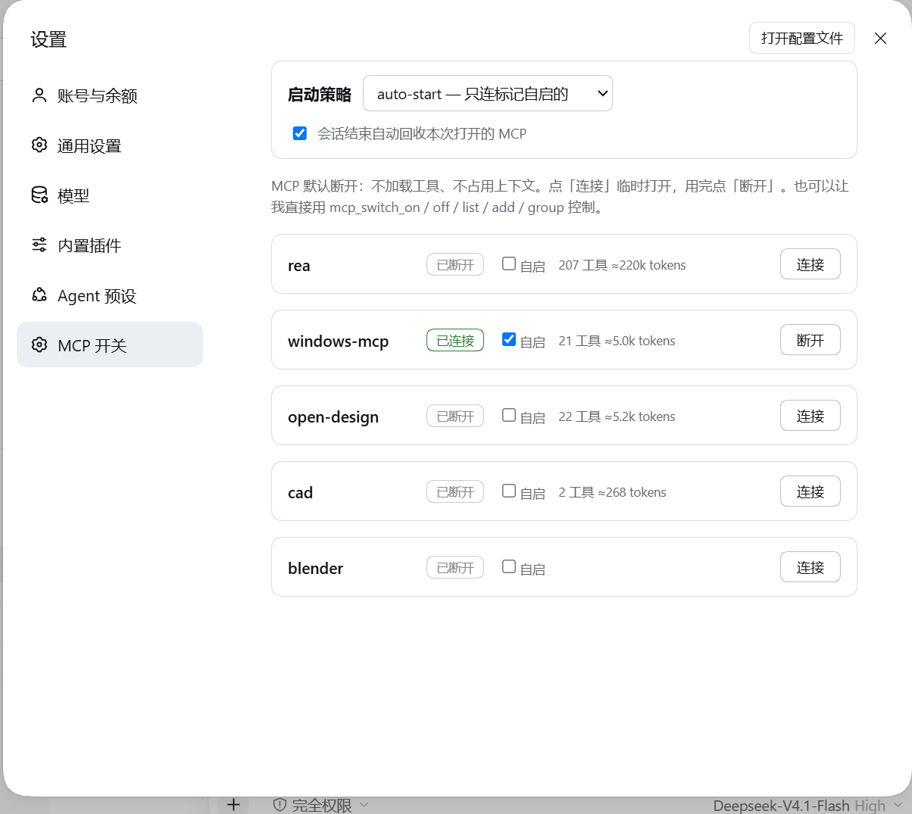

# dsh-plugin-mcp-switch

按需开关 MCP 服务器的 DSH 插件：**默认全部断开**，不加载工具、不占用上下文；需要时再打开。



上图就是设置页：顶部选启动策略、勾选会话结束回收；每行显示状态、自启、**上下文成本**（工具数 / 约多少 tokens），右侧一键连接/断开。

## 七个 agent 工具

| 工具 | 作用 |
|---|---|
| `mcp_switch_list` | 列出服务器、状态、**上下文成本**（工具数 / 约多少 tokens）、启动策略、分组 |
| `mcp_switch_on` | 打开（连接）；`name: "all"` 全开；重服务器需 `confirm: true` |
| `mcp_switch_off` | 断开；`name: "all"` 全断 |
| `mcp_switch_add` | 新增（stdio / streamable-http），env 与 headers 支持 `${VAR}`，token 不落盘 |
| `mcp_switch_remove` | 删除（先断开再移出配置） |
| `mcp_switch_policy` | 读/写 `mode` 与 `reclaimOnSessionEnd` |
| `mcp_switch_group` | 分组预设：list / save / apply / delete |

## 设置页

左下角齿轮 → **MCP 开关**（`settings.section`，order 55，列表末尾）：
启动策略下拉 + 「会话结束自动回收」勾选 + 分组按钮 + 每行（状态 / 成本 / 连接·断开）。

## 启动策略

| `startupMode` | 重启后 | 切换时 |
|---|---|---|
| `always-off`（默认） | 一律断开 | 立即断开全部 |
| `remember` | 恢复上次状态 | 不动当前运行时 |
| `auto-start` | 只连 `autoStart: true` 的 | 连上自启的、断开其余 |

## 上下文成本

连接成功后统计 `mcp__<名称>__*` 的模型可见 schema 体积，估算 tokens 并写回状态文件，断开后仍可显示。
实测（本机）：`rea` 约 86 万 tokens、`windows-mcp` 6.5k、`open-design` 6.0k、`cad` 0.3k。

**重服务器保护**：已知成本 ≥ 10 万 tokens 的服务器（如 `rea`），`mcp_switch_on` / 分组 apply / 设置页「连接」都会先拒绝，要求 `confirm: true`（设置页会提示改用 agent 工具确认）。

## 会话结束自动回收

每个被打开的服务器记住是哪些会话打开的（`openedBy`，一个连接可以有多个拥有者）。拥有者全部被 dispose（`agent/disposed`）后自动断开并落盘。子代理开的 MCP 随子代理结束回收。可用 `mcp_switch_policy { reclaimOnSessionEnd: false }` 关闭——关闭后连接保留、归属清空（即变回对所有会话可见）。

## 按会话可见（2026-11-03 实现，2026-11-24 加固）

连接仍然是**进程内一份**（`rea` 这种 22 万 tokens 的不会每个会话连一次），但工具只对**打开它的会话及其子智能体**可见：

- 实现：MCP 客户端照旧挂在宿主全局 ctx 上注册工具，然后给每个「不拥有该连接的会话」用该会话自己的 `agent.ctx.tools.restrict({ deny: [mcp__<名称>__*] })` 加一层遮挡。模型看不到 = 不付 token；误调也会判 `UNKNOWN_TOOL`。
- 归属判定：`openedBy` 里含该会话，或 `agents.isOwnedBy(sessionId, owner)`（子智能体）。
- 生命周期：`agent/created` 时给新会话补遮挡；连接成功、断开、会话消失时整体重算；`agent/disposed` 时摘掉该会话的全部遮挡。
- 自检：每次遮挡后核对「该会话看不见 + 全局仍注册着」，任一不符就立刻撤销并退回全局，`mcp_switch_list` 的 `scoping` 会显示 `unsupported` 和原因。
- 匿名打开（设置页 / REST API / 启动策略自动连）没有归属会话，**对所有会话可见**——面板上显示「全部会话」。

**开/关对称（11-24 修复）**：`mcp_switch_on` 会记归属，`mcp_switch_off` 现在也只摘当前会话的归属——对话 A 关掉 MCP 不会断掉对话 B 正在用的连接；只有最后一个拥有者关闭时才真正断开。分组 apply 的组外断开同理。面板 / REST 打开的匿名连接仍按全局断开处理。

**归属落盘（11-24 修复）**：`openedBy` 写进 `mcp-switch.json`，重启后清掉已不存在的 stale 会话 id（拿不到 agents 服务时保守保留，绝不误清成匿名把昂贵工具放开给所有人）。

**遮挡稳定性（11-24 修复）**：工具名快照缓存（排序去重后集合不变就不重打 restrict，避免抖动）；`tools/change` 重入由脏标记循环处理，不再被 `syncing` 标志吞掉，带 10 轮上限防自激。

`mcp_switch_list` 会多出一行「会话隔离」和每个连接的「可见：xxx」。

### 测试

`npm test`（24 项）：归属模型的单测、遮挡计划/调度器的单测，以及用假 `ctx` 驱动真实 `apply()` 的 3 项集成测试（关只摘当前会话、最后一个拥有者才断、重启清 stale）。`npm run check` 先做 `node --check` 再跑全部测试。

## 分组预设

```
mcp_switch_group { action: "save", name: "逆向", servers: ["rea"] }
mcp_switch_group { action: "apply", name: "逆向" }        // 组内连上、组外断开
mcp_switch_group { action: "list" }
```

## 状态文件

`~/.dsh/mcp-switch.json`，**原子写**（写 `.tmp` → rename），每次保存前把上一版复制到 `.bak`。

```json
{
  "startupMode": "always-off",
  "reclaimOnSessionEnd": true,
  "groups": { "逆向": ["rea"] },
  "servers": [
    { "id": "…", "name": "rea", "transport": "stdio", "enabled": false, "autoStart": false,
      "cost": { "tools": 207, "bytes": 3087942, "tokens": 857762 },
      "config": { "command": "…", "args": [], "env": {}, "cwd": "" } }
  ]
}
```

首次启动若该文件不存在，会从 `~/.dsh/mcp-console.json` 迁移（全部置为断开）。

## 实现要点

- `@deepseek-ai/dsh-mcp-client` 在 dsh 安装目录的 `app.asar` 内，profile 安装的插件**不能**用裸包名静态 import（开机加载会 `failed to import`），必须按绝对路径动态导入（Electron 认 asar）。
- **2026-10-30 加固（`host-bridge.mjs`）**：旧版把「安装根目录 + `lib/index.js`」都写死，且写在顶层 `await`，任一变化就会让**整个插件**加载失败（不只是 MCP 不可用）。现在按顺序真 import 尝试：裸说明符 → `DSH_APP_MODULES` 环境变量 → 各候选根目录（`resources/app.asar/dsh/node_modules`、`resources/app/dsh/node_modules`、`<execPath>/resources/...`、默认用户安装目录、npm CLI 布局）× 各候选入口（优先读该包 `package.json` 的 `exports["."]` / `module` / `main`，再退回 `lib/index.js` 等）；每个候选都做形状校验（`apply` 必须是函数），全部失败时**不抛异常**，插件照常加载，连 MCP 时明确报「MCP 桥不可用」+ 尝试清单。`GET /mcp-switch/api/state` 的 `bridge` 字段会给出解析结果与来源路径。
- 每个 MCP 通过 `ctx.plugin(mcpClient, config)` 动态挂载，断开时 `fiber.dispose()`；同一服务器的启停串行化，避免 `serverName already in use`。
- `env` / `headers` 的 `${VAR}` 在启动时从进程环境解析，密钥不写进状态文件。
- `/mcp-switch/api/*` 挂在宿主 webServer 上但不受宿主鉴权保护，因此自带同源 + `sec-fetch-site` + 回环 + Host 校验（防跨站开关 MCP、防 DNS rebinding），请求体上限 64KB。

## 安装

```js
plugin_manager install_bundle  target: <这个目录的绝对路径>
```
